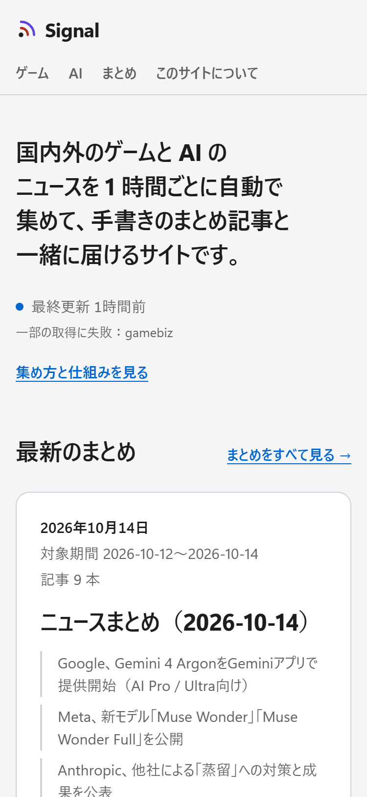
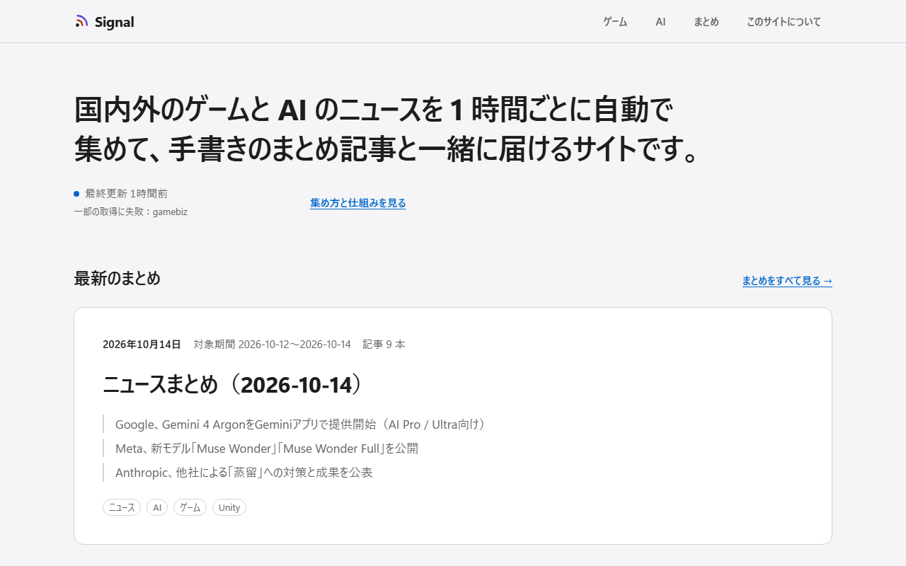
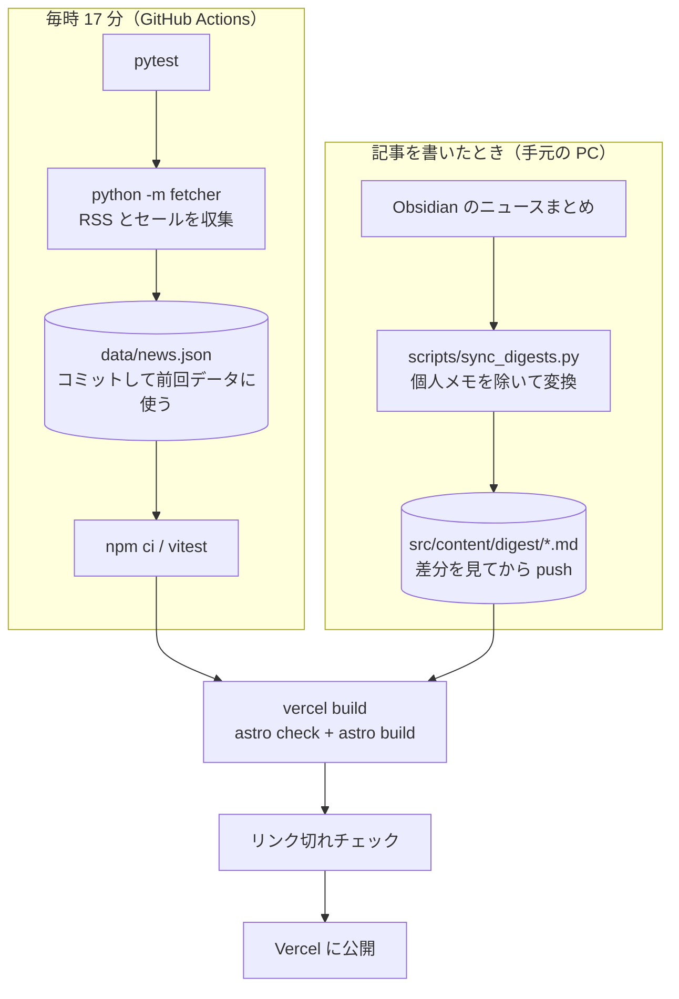

# Signal

<p>
  
  
</p>

公開先：https://game-news-smoky.vercel.app/

国内外のゲームと AI のニュースを 1 時間ごとに自動で集めて、手書きのまとめ記事と一緒に読めるようにしたサイトです。
ニュースは各メディアや公式ブログの RSS から集め、ゲームのほうは Steam・Epic・PS Store・Nintendo eShop のセール情報も載せています。
まとめ記事は、自分が Obsidian で書いているニュースまとめを、個人的なメモを取り除いてから公開しています。

## 仕組み

ニュースは毎時自動で、まとめ記事は書いたときに手で、という 2 本の流れがあり、最後はどちらも同じビルドに合流します。



フォルダの役割はこうなっています。

| 場所 | 中身 |
|------|------|
| `fetcher/` | 収集処理（Python）。ソースごとに 1 ファイル（`rss.py` `steam.py` `epic.py` `psstore.py` `eshop.py`）で、`main.py` が全部を呼んで前回のデータとマージする |
| `data/news.json` | 集めた結果。Actions が毎時コミットする |
| `scripts/sync_digests.py` | Obsidian のまとめを公開用の Markdown に変換する |
| `src/` | サイト本体（Astro）。`pages/` がページ、`components/` が部品、`lib/` が整形や絞り込みの処理とそのテスト |
| `src/scripts/` | ブラウザで動く JS（ニュース一覧の絞り込みやお気に入り） |
| `src/content/` | まとめ記事の Markdown（`digest/`）。`sync_digests.py` が書き出す |
| `tests/` | Python 側のテスト。外部サイトにはつながない |

ニュースの取得元は、国内メディア（4Gamer、IGN Japan、電ファミニコゲーマー、AUTOMATON、gamebiz、Game*Spark）、ハードの公式発表（任天堂、PlayStation Blog、Xbox Wire Japan）、海外メディア（Gematsu、PC Gamer、Kotaku、Eurogamer。タイトルは日本語に翻訳）、AI 関係（ITmedia AI+、Publickey、OpenAI、Google AI、The Verge AI、TechCrunch AI）です。一覧は `fetcher/rss.py` の `FEEDS` にあります。

あるソースの取得に失敗しても、ほかのソースは普通に更新されます。失敗したソースは最後に成功してから 24 時間まで前回のデータを出し、画面には「一部の取得に失敗」と出します。

## 技術を選んだ理由

**サイトは Astro。** 中身は「毎時入れ替わるニュースの一覧」と「たまに書く長めの記事」の 2 種類で、どちらも見る人ごとに変わるものではありません。それならリクエストのたびにサーバーで組み立てる必要はなく、ビルドのときに HTML を作っておけば足ります。Astro は静的生成が基本で、JS を送るのは必要な部品だけにできるので、スマホでも軽く表示できます。Markdown の記事をコンテンツコレクションとして型つきで扱えるのも、まとめ記事に合っていました。

**収集は Python のまま。** このサイトは、もともと Python で集めて素の HTML で出すだけのものでした。収集処理と、各ソースの解析・マージのテストはそのときに作ってあり、ちゃんと動いています。サイトを Astro に移すからといって収集まで書き直すと、壊れていないものを壊す危険があるだけです。なので `fetcher/` はそのまま使い、AI のソースを足すことと、出力先を `data/news.json` に変えることだけをしました。

**デプロイは Actions から直接。** Vercel の Git 連携は止めて、GitHub Actions の中で `vercel build` と `vercel deploy --prebuilt` を呼んでいます。収集、テスト、ビルド、リンクチェック、デプロイが 1 本のジョブに並ぶので、どこかで失敗したらその先には進まず、公開中のサイトは前のまま残ります。Git 連携に任せると、データのコミットとは別のところでビルドが走るので、テストが落ちた状態のものが公開されることがありえました。

## 品質で気をつけたこと

Lighthouse（モバイルの設定、2026-10-25 にローカルでビルドしたものを 2 回ずつ測った良いほうの値）は次のとおりです。

| ページ | Performance | Accessibility | Best Practices | SEO |
| --- | --- | --- | --- | --- |
| `/` | 100 | 100 | 100 | 100 |
| `/game` | 96 | 100 | 100 | 100 |
| `/digest/2026-10-14` | 100 | 100 | 100 | 100 |

外から来たデータはそのまま信用しないようにしています。記事のタイトルや要約は Astro のテンプレートで必ずエスケープして出し、リンクの URL は `http:` と `https:` のものだけを通します（`javascript:` などは `#` に置き換える）。サムネイルの画像は `https:` のものだけを出し、`http:` の画像はサムネイルなしにしています。

日時はビルドのときに JST で文字にしています。Actions のサーバーは UTC で動くので、何もしないと日本時間とずれるためです。

まとめ記事のページは JS がなくても全部読めます。絞り込みやお気に入りのように JS がないと動かない部品は、JS がないときには最初から出さないようにしました。押しても何も起きないボタンが残るよりはいいと考えたからです。

ほかにやったこと：

- ニュース一覧のタブや絞り込みはキーボードだけで操作できる（タブは矢印キーで移動）
- 文字と背景のコントラストは、画面の色は `tokens.css` に集めて（`theme-color` と OGP 画像だけは同じ値を直接書いている）、明るい配色とダークモードの両方で WCAG AA を満たすようにした
- `prefers-reduced-motion` が有効なら動きを止める
- まとめ記事ごとに OGP 画像をビルドのときに作る（satori + resvg）
- sitemap と RSS（`/rss.xml`）を出す
- テストは Python 側が pytest、サイト側が vitest。CI ではこれに `astro check`、ビルド、ビルド結果に対するサイト内リンクのチェックを加え、毎時の更新と PR の両方で動かす

## 手元で動かす

Windows の PowerShell で書いています。Python 3.12 と Node.js 22 以上が必要です。

Python 側（収集とテスト）：

```powershell
py -m venv .venv
.venv\Scripts\python -m pip install -r requirements-dev.txt
.venv\Scripts\python -m pytest
.venv\Scripts\python -m fetcher   # data/news.json を作り直す
```

Node 側（サイト）：

```powershell
npm ci
npm test              # vitest
npm run dev           # http://localhost:4321 で確認
npm run build         # astro check と astro build。結果は dist/ に出る
npm run check:links   # dist/ のサイト内リンクを確認
```

`data/news.json` はリポジトリに入っているので、Python 側を動かさなくてもサイトは表示できます。

## まとめ記事の取り込み

Obsidian で書いたニュースまとめを、公開用に変換して `src/content/digest/` に書き出します。

```powershell
$env:DIGEST_SRC = "<保管庫>\30_ニュース"
.venv\Scripts\python -m scripts.sync_digests
```

読み込む場所は環境変数 `DIGEST_SRC` か `--src "<保管庫>\30_ニュース"` で指定します（どちらもないとエラーで止まります）。書き出す場所は `--dest` で変えられます。

変換では、「自分への影響：」で始まる行（とその下にぶら下がる行）、「※保管庫」で始まる注記の行、Obsidian と HTML のコメントを取り除き、`[[ノート名]]` のリンクを普通の文字にし、プロパティをサイト用の形に直します。元のノートは書き換えません。プロパティの `created` がないなど読めないノートは飛ばして、理由を表示します。終わったら差分を自分の目で確認してから push します。

## 初回だけ必要な設定

GitHub のリポジトリの Settings → Secrets and variables → Actions に、次の 3 つを登録します。

| 名前 | 値 |
|------|----|
| `VERCEL_TOKEN` | https://vercel.com/account/tokens で発行したトークン |
| `VERCEL_ORG_ID` | Vercel のチーム ID（`team_` で始まる） |
| `VERCEL_PROJECT_ID` | Vercel のプロジェクト ID（`prj_` で始まる） |

`vercel.json` で Vercel の Git 連携による自動デプロイは止めています（Actions から直接デプロイするため）。

## 取得元が壊れたとき

- PS Store は公式 API がなく、ストアのページが内部で使っている GraphQL を呼んでいます。取れなくなったら、PS Store の「すべてのセール」ページをブラウザの開発者ツールで開き、`categoryGridRetrieve` の `sha256Hash` を `fetcher/psstore.py` の `QUERY_HASH` に入れ直してください。
- Nintendo eShop は任天堂の検索サイトの API（`search.nintendo.jp`）を使っています。
- 海外記事のタイトル翻訳は非公式の Google 翻訳エンドポイントです。失敗したときは原文のまま表示します。
- RSS のアドレスが変わったときは、`fetcher/rss.py` の `FEEDS` を直します。直したあとは `.venv\Scripts\python -m fetcher` を一度動かし、`data/news.json` でそのソースの記事が取れているかを見てください。

---

作った人：[FSq1v](https://github.com/FSq1v)
